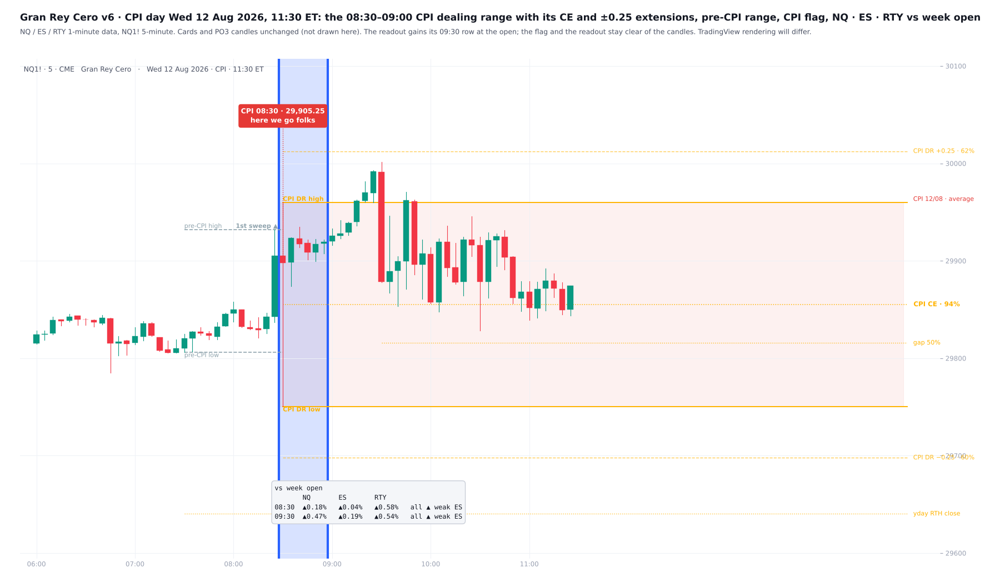
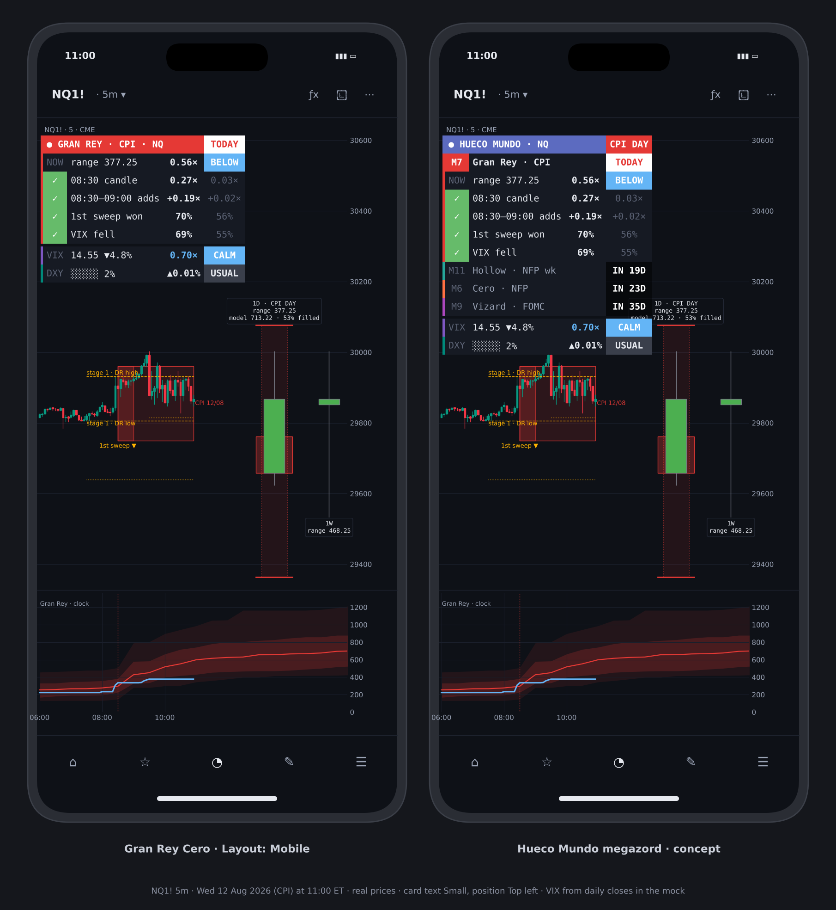

# Gran Rey Cero

**CPI Day Model for NQ & ES**

TradingView indicator, Pine Script v6. Open source under the Mozilla Public License 2.0.

*Mock-up of how it looks on the chart.*

**Gran Rey Cero** maps US CPI release days (08:30 ET) on Nasdaq and S&P futures. It draws the structure the release trades into, sizes a typical CPI day against today's open, tracks the day live against past CPI days, and shows a short list of statistics. Every statistic was tested on 2018–24 and held again on 2025–26. *It is a map of how CPI days usually behave, not a signal generator.*

## What it draws on price

- **Pre-CPI range (07:30–08:29):** stage 1, drawn live from 07:30. It stops at the bar where the release first takes one of its sides, marked **1st sweep**. On NQ the day's bigger move from 08:30 went that way on **70%** of CPI days vs 56% of normal days (2018–24 70%, 2025–26 71%). **Yesterday's RTH close** (16:14 bar) is drawn as the reference for the gap.
- **CPI dealing range (08:30–09:00):** its high and low, drawn live through the window, then fixed at 09:00 and carried to 17:00 (or 11:00 / 16:14), with its CE (50%). Pooled NQ + ES + RTY, 102 CPI days 2018–26:
  - the window ran a median **0.37** ADR20 vs 0.12 on normal days;
  - after 09:00, RTH took its high by 16:14 on 74% of CPI days (normal 89%), its low 70% (87%), both 48% (77%), held in 2018–24, in 2025–26 and on each market;
  - the CE's label gives how often RTH traded back to it after 09:00, by its distance at 08:59: within 0.1 ADR **94%**, 0.1–0.2 85%, 0.2–0.4 71%, beyond 0.4 39%;
  - its direction did not carry: RTH closed the 08:30–09:00 way 48% of the time.
- **CPI flag:** a pill above the release bar, tied by a stem to the 08:30 open and rising with the release push to 09:00: *CPI 08:30 · price* and your wording (default *"here we go folks"*). The day after and other days get a quiet tag (*"you just missed me folks"*, *"nothing to see here folks"*). Empty a wording box to hide that tag.
- **NQ · ES · RTY vs week open:** one readout under the release, with each index against its own week open at 08:30 and again at the 09:30 open. It reads *SPLIT* when they sit on different sides of their week opens (the SMT idea behind Genjutsu Kai) and names the weakest. The weakest at 08:30 was still the weakest at 16:14 on 71% of CPI days, much as on any day (70%): relative strength carries through the day, and CPI doesn't reset it. *A locator, not a direction call.*
- **The 08:30–09:00 window** is marked with full-height lines and shading: strongest on CPI days, lighter on the day after, faint on other weekdays. A box over the window's high and low is optional (off by default, as the dealing range now covers it).
- **08:50 line:** a dotted line separates the release push from what follows. The **RTH gap 50%** level is also drawn.
- **CPI 08:30 candles** (1, 5 or 15 min) are kept and extended right. Each is labelled *wild*, *average* or *quiet*: the top, middle or bottom third of CPI release candles of the same length since 2018, measured against ADR20.
- **PO3 candles:** two PO3-style candles sit right of price. The daily slot holds the **model candle**: the median CPI-day range in ADR20 units, scaled to today's open. The high/low split follows the median reach above and below the open, and the body runs to the median close. Today's live candle fills it from inside. The weekly slot shows the live week. Chips give each range in points and how much of the model today has filled. *The model is a size reference, not a direction call.*

## Event clock (indicator pane)

Today's running range from the 18:00 open (or net move) is drawn against CPI days at the same time of day: median path, 25–75% and 10–90% bands, in half-hour steps scaled to today's ADR20. On other days it compares against normal days and shows the next CPI day's path. A **NOW** status reads *Above*, *Inside* or *Below* the middle half.

## Cards

**Event card**, two modes:

- **Checklist** lists only rows that passed p < 0.05 over 2018–26 and sat on the same side in both 2018–24 and 2025–26. On NQ:
  - the 08:30 one-minute candle is **0.27×** ADR20 vs 0.03× on normal days;
  - the 08:30–09:00 half hour adds **+0.19×** ADR to the day range vs +0.02×;
  - the first sweep side won **70%** vs 56%;
  - VIX closed lower on **69%** of CPI days vs 55%.

  ES shows its own figures; the sweep row is dropped there because it faded on ES in 2025–26.

- **Tally** covers the last N CPI days: up and down closes (trading day and RTH) and the average RTH gap. It also shows where price sits in this week's and this month's range by octant: top quarter = *premium*, bottom quarter = *discount*. *The octant is a locator, not a tested signal.*

**VIX card:** VIX's prior close against its 20-day average. On NQ, days with VIX at least 10% above it ran a median **1.27×** ADR20 (above ADR on 73% of days), within ±10% **0.91×**, and at least 10% below **0.70×**. Added to a range model fitted on 2018–24, it lifted 2025–26 R² from 0.24 to 0.33. A second row gives the same-day relationship: NQ closed up on 78% of days VIX fell. *That describes the day, it does not forecast it.*

**DXY card**, tested on DXY futures Oct 2023 – Aug 2026 and holding in both halves:

- A **battery** shows DXY's range against its ATR20, and another its net move toward ½ ATR (a *big* DXY day).
- On big DXY days NQ closed the other way to DXY **60%** of the time vs 50% on other days (ES 65% vs 53%).
- The 4-week DXY change sets the range: NQ days ran **0.99×** ADR after a 4-week rise vs 0.88× after a fall.
- US 10Y is shown as a live readout only; nothing about it held.

## Why these pieces are together

CPI moves inflation expectations, so equity futures, the dollar and implied volatility all reprice at 08:30 together. Of everything tested, VIX against its own average was the strongest addition to a CPI-day range estimate. The DXY rows describe how index futures tend to finish relative to the dollar on the days the dollar moves hard. The cards give the macro context for the size and finish of the day the structure is drawn on; *each row is there because it held out of sample.*

## Layouts

**View** sits at the top of the settings: Pane (event clock or cards only), Clock measure, Theme, Layout and Card text.

**Desktop** shows every card. **Mobile** shows one narrow card for a phone:

- the event and when;
- **NOW** (the clock in one row);
- the held rows, or the tally, in short form;
- one line each for VIX and DXY.

Full explanations stay in each cell's tooltip.

## How to use

- Built for **NQ / MNQ** and **ES / MES** (continuous or front month). On other symbols the cards say they show NQ figures.
- 1 to 15-minute charts suit the structure; the clock needs 60 minutes or lower.
- Choose the day anchor: CME trading day (18:00), NY midnight or RTH.
- For a phone, use a separate chart layout with *Layout = Mobile*, since chart layouts sync across devices.

## Data and method

- NQ and ES 1-minute data, Jan 2018 – Oct 2026 (ES to Aug 2026), about 96 CPI days.
- Training period **2018–24**, test period **2025–26**. A row is shown only if it passed p < 0.05 over the full sample and sat on the same side in both periods.
- **ADR20** = mean (high − low) ÷ open over the last 20 complete days.
- Release dates come from the BLS schedule and are loaded to Dec 2027, including the moved 2025 dates; add new years in S_CPI and raise LAST_DATE.
- Higher-timeframe values are read without lookahead on history: completed daily values only, and the weekly and monthly ranges only on the last bar.

## Limitations

*These are historical frequencies on about a hundred events: useful context, not guarantees.* Same-day rows describe how days finish and cannot be known in advance. The VIX and DXY cards need the CBOE:VIX, TVC:DXY and TVC:US10Y feeds.

## Credits

ICT concepts (*Michael J. Huddleston*): dealing range, premium and discount, PO3. The PO3 right-side candle layout follows a common community display idea. Written from scratch; open source under MPL 2.0.

## Add it to TradingView

1. In TradingView, open the **Pine Editor** (bottom panel).
2. Copy the contents of `Gran_Rey_Cero.pine` into a new script.
3. **Save**, then **Add to chart**.

## More screenshots

## License

Mozilla Public License 2.0, see [LICENSE](LICENSE). © Unclehk2000.

*Historical frequencies, not guarantees. Nothing here is financial advice.*
